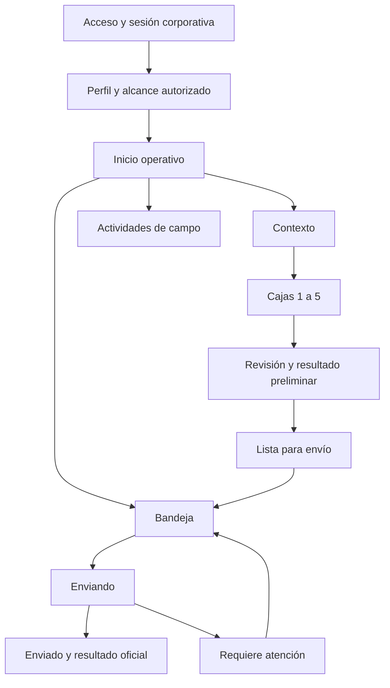

# HU2654 · Recorridos y estados móviles

**Paquete:** Pulso de captura 0.9.0, propuesta para revisión de Producto.  
**Fuente visual:** `DESIGN.md`, `handoff/tokens.ts` y prototipo v0.8.  
**Autoridad funcional:** HU2623, HU2625, HU2632, HU2635, HU2638, HU2641 y HU2644 de Banasan Captur.  
**Destino:** HU2653 implementa la presentación en React Native / Expo. Esta especificación no acredita implementación.

## 1. Decisiones de presentación

- Pulso conserva carbón, coral, papel, Archivo Variable e isotipo v06. El coral señala la acción principal y el avance; nunca es la única señal de un resultado.
- La cabecera de captura usa una sola secuencia: **Contexto → Cajas → Revisión**. Dentro de Cajas se muestra **Caja 1 de 5** a **Caja 5 de 5**; la cuenta no crea un cuarto paso ni admite una sexta caja.
- El área de trabajo es clara para lectura y digitación en campo. Las escenas oscuras quedan en orientación y cabeceras. Cada mensaje crítico combina texto, icono y una acción contextual; color y animación son apoyo.
- Una inspección tiene dos ejes visibles e independientes: **estado de trabajo/transmisión** y **resultado de calidad**. El resultado preliminar se etiqueta como tal incluso cuando hay conexión. Sólo una confirmación de la API permite presentar un resultado oficial.
- La semana y la cinta proceden del calendario SIAL. Su nombre, valor, significado y color oficiales se representan sin reinterpretación cromática. Compañía, finca y referencia son selecciones autorizadas de solo lectura; Capturer no administra esos maestros.
- Las transiciones no retrasan guardado ni bloquean captura. En movimiento reducido, el cambio es inmediato. No se anima una fila repetida ni un estado que exige decisión.

## 2. Mapa de recorrido

La navegación hacia Contexto requiere sesión y alcance efectivos. Un borrador recuperado vuelve al último campo o caja pendiente con sus valores y fotos asociados. Cambiar de usuario o perder permiso se resuelve con el contrato de sesión de HU2623; no se muestran datos de otra compañía o finca.

## 3. Contrato por pantalla

| Pantalla | Jerarquía y datos visibles | Acción principal | Errores y recuperación |
| --- | --- | --- | --- |
| Acceso | Marca, estado de sesión y preparación local; identidad corporativa | Ingresar cuando el servicio y la sesión lo permitan | Error junto al campo o aviso persistente; reintentar. Sin credenciales locales inventadas. |
| Perfil/alcance | Persona, compañía, fincas y capacidades autorizadas | Continuar al Inicio | Sin permiso: explicar el alcance faltante y ofrecer cambio de contexto o salida permitida. |
| Inicio | Nueva inspección, actividad de campo y bandeja con conteos reales | Empezar inspección | Carga, vacío, sin permiso y sin red tienen texto y ruta de recuperación. Un conteo nunca equivale a envío confirmado. |
| Contexto | Compañía, finca, semana/cinta SIAL, lugar, referencia código+versión y revisión de calidad, además de campos logísticos aplicables | Guardar y continuar a Cajas | Marcar el campo exacto; conservar selección y borrador. La ausencia de un maestro o permiso bloquea el avance con causa visible. |
| Cajas 1–5 | Indicador de caja única, peso bruto, empacador, primera impresión, distribución, medidas, defectos y fotos por ocurrencia según configuración publicada | Guardar caja y continuar | Mostrar pendientes junto a cada dato; foto faltante en la ocurrencia correspondiente. Guardar al navegar; volver conserva contenido. |
| Revisión | Resumen de contexto, cinco cajas, fotos, métricas y disposición **preliminares**, pendientes y estado de guardado local | Marcar lista para envío sólo tras validación/revisión | Cada pendiente lleva a la caja/campo/ocurrencia exacta. Sin red se conserva la revisión y se explica que el resultado aún no es oficial. |
| Bandeja | Filas separadas de Borradores, Lista para envío, Enviando, Requiere atención y Enviados; cada fila muestra finca/referencia, fecha y ambos ejes de estado | Continuar, consultar o reintentar según estado | Un fallo conserva el registro y su identidad; reintentar no inicia otra inspección. |
| Detalle enviado | Confirmación de recepción, resultado oficial y evidencia asociada cuando la API lo confirme | Consultar resultado | Si falta confirmación de evaluación, permanece pendiente; no se fabrica un resultado oficial. |
| Actividades | Tipo, finca/lugar autorizado, inicio/cierre y evidencia aplicable | Iniciar o cerrar según fase | GPS se solicita en contexto; permiso denegado, precisión insuficiente o timeout muestran causa y reintento. No se inventan coordenadas. |

La obligatoriedad, rangos, fórmulas, permiso de acción y política de GPS vienen de las HU funcionales y de la configuración publicada. La UI muestra esa regla y su origen; no codifica umbrales en tokens ni en el componente.

## 4. Matriz de estados ortogonales

| Eje | Estado visible | Texto mínimo y símbolo | Acción disponible | Condición de salida |
| --- | --- | --- | --- | --- |
| Trabajo | Borrador · guardado localmente | Documento · «Guardado en este dispositivo» | Continuar/editar | Revisión válida y transición durable a Lista para envío |
| Transmisión | Lista para envío | Bandeja · «Pendiente de envío» | Consultar; envío según política de HU2641 | Inicio real del envío |
| Transmisión | Enviando | Flecha de progreso · «Enviando» | Ver progreso; no duplicar envío | Confirmación completa o error recuperable |
| Transmisión | Requiere atención | Triángulo · causa y siguiente acción | Reintentar o corregir, según causa | Nuevo intento con identidad estable o regreso explícito a borrador |
| Transmisión | Enviado | Verificación · «Enviado y confirmado» | Consultar detalle | Confirmación API del agregado, evidencias y resultado oficial |
| Calidad | Sin cálculo | Guion · «Resultado pendiente» | Completar/revisar datos | Vista previa calculable |
| Calidad | Preliminar sin novedad | Documento de lectura · «Resultado preliminar» | Revisar | Resultado oficial confirmado |
| Calidad | Preliminar con novedad o disposición | Aviso · «Novedad preliminar» y disposición textual separada | Revisar detalle; corregir dato cuando aplique | Resultado oficial confirmado o nueva revisión local |
| Calidad | Oficial | Sello de confirmado · «Resultado oficial» con disposición textual | Consultar | Sólo nueva versión/acto autorizado por la HU dueña |

**Combinaciones obligatorias:** un borrador puede mostrar resultado preliminar; Lista para envío y Enviando pueden conservar una novedad preliminar; Requiere atención puede conservar ese preliminar sin declarar recepción; Enviado exige resultado oficial. «Novedad» describe calidad, nunca fallo de red. Una disposición adversa no se presenta como error de guardado.

## 5. Acciones, permisos y persistencia visible

| Acción | Visible/disponible | Confirmación y efecto mostrado | Autoridad |
| --- | --- | --- | --- |
| Elegir finca/referencia | Sólo opciones de alcance efectivo | Muestra código+versión SIAL y revisión de calidad; cambio de contexto no mezcla datos previos | HU2623/HU2625/HU2628 |
| Continuar de Contexto | Al cumplir campos y configuración aplicables | «Guardado en este dispositivo» sólo tras persistencia local; abre Caja 1 | HU2632 |
| Guardar caja | Una de 1–5, con datos y ocurrencias vinculados | Conserva caja y fotos durables; siguiente caja o Revisión | HU2635 |
| Marcar lista para envío | Cinco cajas completas, fotos requeridas y revisión válida | Cambio durable a «Lista para envío»; no dice «Enviado» | HU2638/HU2641 |
| Reintentar envío | Sólo en fallo recuperable y con permiso efectivo | Mantiene identidad del envío y contenido; progreso visible | HU2641 |
| Consultar oficial | Sólo tras confirmación de API | Etiqueta «Resultado oficial» y datos devueltos | HU2638/HU2641 |
| Iniciar/cerrar actividad | Capacidad autorizada y fase aplicable | Estado local y GPS según regla publicada; permiso se solicita al ejecutar | HU2644 |

Las acciones destructivas, salida con trabajo pendiente, cambio de identidad y conflicto requieren la política funcional de la HU dueña antes de diseñar un diálogo definitivo. El botón no concede permisos: la API valida cada operación.

## 6. Estados transversales y copy de referencia

| Caso | Presentación y siguiente acción |
| --- | --- |
| Cargando catálogos o alcance | Esqueleto breve con título de sección y «Cargando datos para inspeccionar». Mantener el contexto ya conocido. |
| Vacío sin borradores | «Aún no hay inspecciones guardadas en este dispositivo». Acción «Empezar inspección» si está autorizada. |
| Sin conexión con borrador durable | «Puedes seguir capturando. Los cambios se guardan en este dispositivo». El estado de red no sustituye el estado del borrador. |
| Sin conexión sin datos requeridos | «Necesitas conexión para obtener [dato requerido]». Acción «Reintentar»; no simular catálogo. |
| Permiso denegado | «No tienes acceso a esta finca o acción». Acción de cambio de contexto/salida según sesión; no mostrar datos restringidos. |
| Campo obligatorio ausente | «Completa [nombre del campo] para continuar». Mensaje adyacente, foco y enlace desde Revisión. |
| Foto de ocurrencia ausente | «Añade la foto de esta ocurrencia». Acción de cámara en la ocurrencia; conservar el resto de la caja. |
| GPS denegado o impreciso | «No pudimos obtener una ubicación válida». Mostrar causa conocida y «Reintentar ubicación»; no rellenar coordenadas. |
| Envío interrumpido | «La inspección sigue pendiente de envío». Acción «Reintentar» cuando proceda; no toast efímero. |
| Evaluación remota pendiente | «Datos recibidos; resultado oficial pendiente». Mantener fuera de Enviados hasta cumplir HU2641. |

El copy final se valida con Producto y con el contrato efectivo. Los mensajes no muestran errores técnicos, IDs internos ni un éxito que el sistema no haya confirmado.

## 7. Dispositivo, accesibilidad y degradación

- En teléfono, una columna y acción fija que respeta safe area y teclado. En tableta, el formulario conserva una columna de lectura y puede añadir panel de resumen sin duplicar acciones ni perder foco.
- Objetivos táctiles de al menos 44 × 44 pt; preferencia de 50 pt para acción primaria. Etiquetas persistentes, orden de lectura lógico, foco en primer error y anuncio asistivo al cambiar estado de guardado/transmisión.
- Texto dinámico, sol intenso y contraste se verifican en hardware. El valor de cinta SIAL conserva su semántica corporativa y lleva etiqueta textual; su color no reemplaza el mensaje.
- Blur/fotografía son orientación. Formularios, errores, métricas y confirmación usan superficies opacas. Si falla la imagen o se activa movimiento reducido, el flujo sigue completo.
- Al volver de cámara, reiniciar la app o perder red, la pantalla reconstruye el borrador persistido y conduce al pendiente exacto. La prueba nativa corresponde a HU2653 y a las HU funcionales.

## 8. Decisiones pendientes para aprobación

1. Producto revisa esta matriz y registra aprobador, fecha, versión y cambios. Hasta entonces es propuesta, no identidad final aprobada.
2. Confirmar los textos y destinos de cambio de compañía/finca, expiración de sesión, salida con borrador y conflictos con el contrato de HU2623/HU2641.
3. Confirmar en la configuración publicada los nombres, unidades y visibilidad de medidas, reglas por referencia y disposición; la decisión CLSIEGEL sigue en HU2628/HU2635.
4. Validar en teléfono y tableta reales el icono a 32/64 px, máscaras, Archivo Variable, contraste al sol, tamaño de texto, lector de pantalla, teclado, cámara y safe areas.
   La revisión estática del PNG a 32/64 px en fondo claro y oscuro conserva la silueta, pero el recurso de launcher incluye fondo marfil opaco; faltan variantes raster transparentes para usos de marca fuera del launcher. Los lockups SVG existentes sí son transparentes.
5. El prototipo v0.8 conserva un ejemplo de dos pasos y no representa el recorrido completo de esta especificación. HU2653 debe consumir la versión aprobada de esta matriz, no inferir las cinco cajas desde ese ejemplo.

**Trazabilidad:** HU2654 CA1–CA8; HU2653 consume el paquete; HU2632/2635/2638/2641/2644 conservan la lógica. `SELF`: slice de diseño y handoff con fuentes locales y autoridad funcional distribuida; delegar el contexto no ofrece beneficio independiente proporcional.
